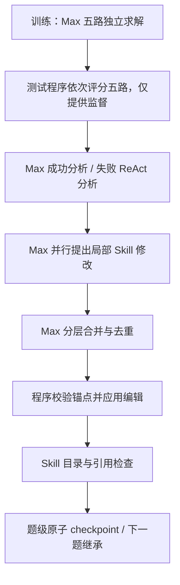

# RSI：Trace2Skill / ReasoningBank 聚合 Skill

Click 15 题实验配置 `configs/agent/click15-flash-max.yaml` 将总轨迹数和同时运行数分开：当前 `rollouts: 5`、`rollout_workers: 1`，即串行生成同题五条独立轨迹。每路使用相同的当前 Skill 和独立仓库快照，完成后立即落盘，再启动下一路；全部五路完成后才正式评分并学习。需要并发时仅调整 `rollout_workers`（先前已验证并发上限 3）。其他配置未设置该字段时沿用原来的并发数量。冻结回测为单路 Flash、温度 0。半题中断后的恢复规则仍是保留未提交尝试并整题重跑。

两套独立学习框架，均以 qwen3.8-max 为基座，五路独立代码求解、五路正式监督，最终更新可复用 Skill。只优化外部文档，不训练模型权重。每题五路共用同一份当前 Skill，评分后由所选框架更新，供下一题继承。Trace2Skill 使用逐路分析与分层合并，ReasoningBank 聚合模式直接联合对比五路后重写 Skill。


## 两套框架与 CLI

`trace2skill` 将现有完整流程封装为一个框架：逐路成功/失败分析 → 官方并行 MAP → 分层 REDUCE → 翻译、应用与验证。上游及适配器位于 `rsi/skills/trace2skill/`，统一入口位于 `rsi/frameworks/trace2skill.py`。

`reasoningbank` 借鉴 [ReasoningBank / MaTTS 的并行 self-contrast](https://github.com/google-research/reasoning-bank)，将同一题五路完整轨迹、正式评分和当前 Skill 一次性交给 Max 对比聚合，直接重写一个统一的 `SKILL.md`。下一题加载更新后的完整 Skill。此模式不创建记忆库、不检索记忆、不走 Trace2Skill 分析和编辑器；已有参考文件与固定工具保持只读。成功和失败共同提供证据，但失败不等于已知原因，不声称未测试的修复成功。

这是聚合方法的 Skill 化适配，并非官方 ReasoningBank 记忆框架复现。两者共享求解器、评分、Skill 版本存储和原子 checkpoint，学习流程彼此独立。训练时用正式评分替代论文中的自评信号。

```powershell
# 两个命令选择框架；参数、任务和预算保持一致
python -m rsi.cli trace2skill --benchmark-config configs/benchmark/python-smoke-two.yaml
python -m rsi.cli reasoningbank --benchmark-config configs/benchmark/python-smoke-two.yaml

# 等价的显式选择
python -m rsi.cli run --framework reasoningbank --tasks tasks/click-chain-train.json

# 冻结最终 Skill 测评；不会更新 Skill
python -m rsi.cli reasoningbank --tasks tasks/click-chain-eval.json --initial-skill <训练运行目录> --fixed-skill

# 恢复使用运行目录保存的模型、框架和任务；拒绝切换框架
python -m rsi.cli run --resume <运行目录>
```

所有模型角色统一使用服务标识 `qwen3.8-max`。旧 Flash 配置需要更新；已开始的运行恢复时仍使用原来保存的配置。`run` 默认使用配置中的 `skill_update_method`（默认 `trace2skill`），两个框架命令可直接覆盖该字段。

聚合设置为 `reasoningbank.timeout`（默认 1800 秒，初次生成与全部修复共用）和 `reasoningbank.max_repair_rounds`（默认 3，即初次生成后最多再修复三轮）。JSON 格式、元数据、引用或存储文档检查失败时，自动把上一版提案及具体错误连同原始轨迹和初始 Skill 交回 Max，要求输出完整修复版，再运行同样的程序检查。检查通过后才提交；修复耗尽则记录 `checks_failed`，保留旧 Skill，提交已完成的监督结果并继续下一题。无可靠改进时允许返回不更新。API、网络、超时等运行异常仍中止且不提交该题，恢复时重跑，不作为文档修复处理。

聚合与逐轮修复的请求/响应、用量和状态保存在每题 `reasoningbank/`，检查历史见 `validation.json`；完整文档提案保存在 `proposal.json`，差异保存在 `skill.diff`。全部修复调用计入学习用量。程序检查不判断经验内容的正确性，尚无新增 Skill 的解题效果采纳门槛。

以下流程与分析预算说明专指 Trace2Skill。



## 模型与预算

配置为 `configs/agent/qwen.yaml` 或 `configs/agent/python-pilot.yaml`。

| 配置项 | 模型 | 用途 |
|---|---|---|
| `model` | qwen3.8-max | 五路求解 |
| `judge_model` | qwen3.8-max | 测试答案选择、求解 action 格式修复 |
| `skill_editor_model` | qwen3.8-max | Trace2Skill 修改提议、合并、翻译和验证修复 |
| `skill_error_model` | qwen3.8-max | 正式失败轨迹的工具分析 |
| `skill_success_model` | qwen3.8-max | 正式成功轨迹的单次分析 |

程序强制上述路由。每路初始调用预算为 100，动作格式修复尝试也计入；每路默认 30 分钟。旧的逐路反思和续写、旧全文更新器已删除，旧配置字段会被拒绝。

Trace2Skill 默认最多并发分析两路；每路失败分析最多 8 轮工具交互，整次学习最多 1800 秒。MAP 每批一条分析记录，REDUCE 每批最多五份修改，最多三个合并层级。具体配置见 `trace2skill` 块。

## 深度思考的接收与归档

模型角色配置 `extra_body.enable_thinking: true` 时，调用层默认使用流式输出并请求最终用量；显式设置 `stream: false` 仍可使用非流式调用。关闭思考的既有配置保持原调用方式。未增加思考预算，也未修改模型、温度、请求超时、重试次数、调用数或任务总时限。

求解器在每路目录的 `model-stream.jsonl` 实时追加思考正文与最终回复片段；动作格式化、联合编辑和 Trace2Skill 调用使用各自请求旁的 `*.stream.jsonl`。日志按请求及重试编号区分，包含 `start`、`reasoning_delta`、`content_delta`、`complete` 或 `error`。每段写入后刷新，断流前已收到的内容会保留。思考正文仅作本地归档，不加入后续求解消息或 Skill 学习证据；轨迹消息仍保存最终回复与用量。

完整流结束且有结束标记及用量后，才向原动作校验器提交最终回复；中途断流或缺少结束信息按调用失败处理，重试不拼接不同尝试的内容，也不额外计为成功求解步骤。用量取服务端最终总数一次，思考 token 已包含于输出 token，不重复相加。流式请求的 `timeout` 约束 SDK 网络读取等待，任务剩余总时限仍会检查并关闭流；持续有输出不再要求整个回复必须在一个读取等待窗口内生成完毕。恢复规则与 checkpoint 格式不变，未提交尝试及其思考日志会一并归档后整题重跑。

## 实际复用的上游

官方 [Qwen-Applications/Trace2Skill](https://github.com/Qwen-Applications/Trace2Skill)，固定提交 `3d0b52a140f002a512930252b613c49048f7d5ac`。
源码位于 `vendor/Trace2Skill-upstream`，运行前按 `rsi-source-manifest.json` 验证文件哈希和锁定版本。
上游仅加一处解析失败日志目录转发补丁，详情及补丁文件见 `THIRD_PARTY.md`。

- 失败分析直接使用官方 `ReActAgent`，由 SWE 适配器提供原始证据读取、源码读取、隔离 Python 诊断工具。
- 成功分析使用 Max 单次调用，提取有评分支持的操作方法。分析提示词和数据结构已从电子表格适配为软件仓库。
- 编辑器直接使用官方 `CombinedParallelSkillEvolver` 的并行 MAP 和分层 REDUCE；程序式 APPLY 使用官方实现。
- 直接调用官方完整 `run()`：MAP、REDUCE、TRANSLATION、APPLY、VERIFICATION，保留官方解析修复、批次跳过和回退行为。

这不是直接运行上游 SpreadsheetBench，也不声称在 SWE 数据上复现论文收益。适配器和复用边界见 `THIRD_PARTY.md`。

## 五路监督与正确率

训练与测试通过 evolve / fixed_skill 配置区分，使用同样的五路求解预算。

训练（`evolve: true`）不调用答案选择器，不统计正确率。五路均评分，仅用于监督学习；训练 summary 的 `selected` 和 `success` 为 null，`supervision_complete` 表示五路评分完整。训练 metrics 不包含 accuracy，记录监督题数、路数、耗时和 token。

测试（固定 Skill）在评分前选路，只对选中路线评分并统计正确率，不运行分析或更新 Skill。其他路线不能替换选中结果。训练完成后通过 pilot evaluate 命令固定最终 Skill 版本。

五路监督写入 `supervision.json`（schema 2）：每路包含独立结果、补丁哈希、测试清单和错误断言片段。每个结果桶最多带入 100 个测试名称，每路错误片段最多 24000 字符，数量与遗漏显式记录。评分反馈不做 LLM 压缩。参考补丁不传入模型。

失败分析可以分页读取完整原始日志；对 SWE/SWE-Evo 可以按需启动原始镜像、应用该路最终补丁，并在隔离容器内读取代码、运行定向 Python 诊断。分析容器禁止联网，不挂载宿主目录或凭据，默认 512 MiB、1 CPU、128 PID、每条命令 30 秒，分析结束强制清理。分析不改变原提交或正式评分。Terminal 任务支持归档证据分析，不提供 SWE 仓库诊断工具。

## Skill 修改边界

采用官方目录式更新：局部编辑 `SKILL.md` 和 `references/*.md`，允许创建、删除参考文档。主文档保存通用流程，低频但可复用的具体知识放入带适用范围的参考文档。每个参考文件必须从主文档链接；删除时同步移除引用。固定脚本和检查文件不可修改。编辑解析、引用配对与冲突处理交由官方实现。无法得到有证据支持的经验时允许不更新。

分析使用官方 Markdown 报告格式；失败报告先通过正式 PASS 身份门控，再调用 `parse_items()` 解析器；成功解析保持原有流程。不要求自定义 diagnosis/lessons JSON，不做引用逐字匹配。失败分析使用官方 ReAct 工具协议；提前结束但尚无正式 PASS 时，使用官方 continuation API 在原预算内续跑一次，不重置轮数。预算耗尽时只加一轮报告收束。仓库配置使用 20 轮调查预算。报告从最后一条最终助手响应中提取，仅移除独立的 `ACTION: TASK_COMPLETE` 行，保留标记前后的报告正文。

普通正式 FAIL/UNVERIFIED 报告不会进入失败经验编辑；无可解析条目时不生成该路更新。API、模型、分析运行或正式评分基础设施异常会保存错误、取消待执行分析并中止该题，不再作为 `no_changes` 提交 checkpoint。MAP/REDUCE 保留官方解析修复与空更新行为；底层模型调用失败即使被上游捕获，也会向外围报告并阻止提交。不额外要求五路全部生成修改。

不再进行额外的轨迹摘要或 Skill 全文压缩，移除了旧 8000/12000 字符文档上限。Max 逐路读取完整已记录消息、任务、最终补丁、评分证据和当前 Skill 目录；初始上下文包含在消息中。Max 合并局部修改，不汇总五路原始日志。求解器只预加载主文档，参考文件安装在 `/opt/rsi-skills/references/` 下按需读取。

测试选择器仍一次接收五路完整轨迹，因此请求可能较大。无摘要不等于无限上下文：模型服务的上下文及输出限制仍生效；超限报错不静默截断，不提交失败题目。命令观察原有输出截断及诊断工具分页边界仍保留，原始命令日志另外归档。

新版本采纳前检查文件路径、非空文档、固定工具完整性、Markdown 本地链接，以及“修改前后复测”与“无条件禁止重复探针”的明确冲突。一致性检查覆盖范围有限，不是一般语义正确性判断。错误交回两种框架各自已有的有限修复流程，不新增求解或学习阶段。历史 Skill 仍可加载，产生新版本时才要求通过新增检查。

更新记录使用 `decision: document_checks_passed`、`validation_scope: document_consistency` 和 `effectiveness_evaluated: false`。这些标识只表示文档验收通过；没有加入验证集性能采纳门槛，成功更新不代表解题收益或跨题通用性已获证明。

## 环境与运行

本仓库保留现有本地依赖布局：`RSI_DEPENDENCY_ROOT` 默认 `D:/RSI`，复用其中的 mini-SWE-agent、SWE-bench/Harbor、缓存数据和 Docker 镜像。Trace2Skill 源码包含在本仓库的 vendor 目录。Python 依赖见 `pyproject.toml`。凭据通过 `QWEN_TOKEN_PLAN_API_KEY` 环境变量或已有 `.env` 加载，不写入配置与请求日志。

在仓库根目录运行：

```powershell
& 'D:/RSI/.venv-py314/Scripts/python.exe' -m rsi.cli doctor
& 'D:/RSI/.venv-py314/Scripts/python.exe' -u -X utf8 scripts/monitor_experiment.py --benchmark-config configs/benchmark/python-smoke-two.yaml
```

已有 Python 数据划分维持 10 题训练、10 题冻结测评：

```powershell
& 'D:/RSI/.venv-py314/Scripts/python.exe' scripts/run_python_pilot.py check
& 'D:/RSI/.venv-py314/Scripts/python.exe' scripts/run_python_pilot.py train
& 'D:/RSI/.venv-py314/Scripts/python.exe' scripts/run_python_pilot.py evaluate --training-run <本次完成的训练目录>
```

## 日志与恢复

训练保留五路 `score.json`、`all-route-scores.json`、`supervision.json`、分析及更新日志；不写题级 `score.json`、`selection.json` 或 `predictions.json`。测试保留选择结果、所选补丁及评分。两阶段均保存 summary、耗时和用量。

`trace2skill/` 保存：输入快照、逐路分析与工具观察、每次模型请求响应及 usage、MAP 修改、各层合并、最终修改和总用量。全部调用（含失败尝试）计入学习用量，采纳后汇入题目统计。

checkpoint schema 5 在评分和学习结束后原子提交，保存当前 Skill 指针。未被官方内部处理的运行/API/评分异常不提交该题；普通评分 false 可以继续。文档提案被拒绝时保存旧 Skill 和拒绝原因。任务中途恢复会归档未提交尝试并重跑整题，已提交题目不重复调用模型。

```powershell
& 'D:/RSI/.venv-py314/Scripts/python.exe' scripts/monitor_experiment.py --resume <本次中断的运行目录>
```

旧算法运行日志完整保留在 `runs/`，开发与迁移材料位于忽略的 `_work/`，不属于现行代码流程。schema 1/2/3/4 的旧 checkpoint 不能按新训练语义恢复，旧逐路反思配置明确拒绝。

离线回归命令：`python -m unittest discover -s tests -q`。测试使用确定性模型替身和官方 Trace2Skill 运行时，不发起真实模型请求。验证范围见 `VALIDATION.md`。

## 官方对齐边界

固定 GitHub 提交不变。SWE 适配仍负责把正式评分与代码轨迹交给分析器，提供源码读取和隔离 Python 诊断；电子表格专用的 gold.xlsx / evaluate_output 及其 PASS 标志不适用于 SWE，并未伪造这些标志。成功分析沿用官方提示词并替换任务领域，失败分析保留官方报告要求、替换电子表格环境说明。

官方验证入口运行 `skills/skill-creator/scripts/quick_validate.py`，使用 anthropics/skills 固定提交的原版脚本；来源、提交和 SHA256 见 `skills/skill-creator/upstream.json`，许可证同目录保留。初始 Skill 已补齐 YAML 元数据，适用范围仅为 SWE-bench 软件修复，不覆盖一般终端任务。没有另外加入性能采纳门槛。

## 失败经验 PASS 门控

失败报告进入编辑器前，必须有当前分析运行的正式 SWE-bench PASS 记录，且最终诊断补丁与提交评测的补丁 SHA256 一致。失败原因与失败经验共同门控，成功分析不受影响。统计见每题 `trace2skill/failure-filter-summary.json`，实际编辑输入见 `trace2skill/editor-records.json`。状态、恢复与离线测试说明见 [FAILURE-PASS-FILTER.md](FAILURE-PASS-FILTER.md)。


### GPT-6 Luna / Sub2API

新增独立配置 `configs/agent/gpt6-luna.yaml`，仅求解使用 `gpt-6-luna`；评分、失败分析、成功分析和技能编辑保持原 `qwen.yaml` 中的 `qwen3.8-max` 配置。原 Qwen 配置与默认入口保持不变。

密钥从根目录 `.env` 的 `SUB2API_API_KEY` 加载，不写入 YAML。默认接口为 `https://www.sub2api.com/v1`；如果密钥来自其他站点，需要修改求解角色 `model.api_base`。其他角色继续使用 `QWEN_TOKEN_PLAN_API_KEY`。Luna 使用现有 Chat Completions 调用链，设置 `reasoning_effort: none`，不发送 Qwen 的 `enable_thinking` 参数。

运行时指定 `--config configs/agent/gpt6-luna.yaml`（例如 `python -m rsi.cli run --tasks <任务清单> --config configs/agent/gpt6-luna.yaml`）。本地配置校验不代表上游凭据或模型权限有效，需实际请求验证。

## P0：可选的 Skill 索引与版本事务

新增目录模式默认关闭。新 Trace2Skill 运行可显式设置 `skill_directory: {schema: 1}`，启用程序管理的 `routing/index.yaml`、完整目录原子物化、安装校验和 Checkpoint Schema 6。旧模式及 Schema 5 恢复保持兼容；迁移、检索、整理功能尚未实现，不能开启。接口、限制与安全回退命令见 [P0 说明](docs/skill_routing_p0.md)。
