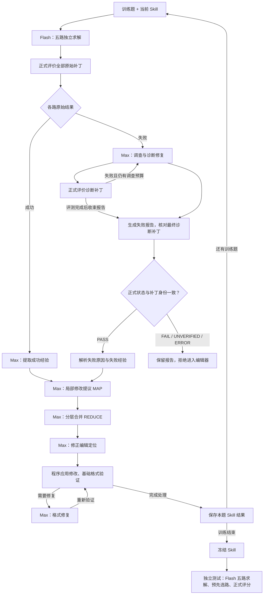

# Trace2Skill：当前训练与 Skill 更新流程

当前方案面向 SWE-bench 软件修复任务：**Flash 负责解题，Trace2Skill 内的全部模型调用使用 Qwen3.8 Max。**

训练时，每道题独立生成五路补丁，从成功轨迹和经过正式修复验证的失败轨迹中提取经验，统一更新 Skill。下一道题使用新 Skill；模型权重不变。

以下按一道训练题的执行顺序说明。

## 第一步：Flash 使用当前 Skill，独立求解五路

将同一道题和当前 Skill 交给五个 Flash 求解实例。各路使用独立环境，中途不交换信息。

每路输出：

- 一份最终代码补丁。
- 一条求解轨迹，包含操作、工具观察、尝试和修正过程。

每路最多消耗 100 次求解调用及 action 格式修复尝试，最长 30 分钟。求解 action 的格式修复仍由 Flash 执行。

## 第二步：正式评价五份原始补丁

分别运行 SWE-bench 正式评测，获取每路原始补丁的成功或失败结果，以及测试反馈。

这些结果用来分配分析方式：

```text
原始补丁通过 → 成功轨迹分析
原始补丁失败 → 失败调查与诊断修复
```

**训练阶段不选择一路答案，也不统计任务正确率。** 五路都提供学习机会，但不保证五路最终都能形成可接受经验。

## 第三步：Max 分析轨迹，失败路线尝试修复

### 原始补丁成功：提取有效方法

Max 通常通过一次调用，梳理精简的成功路径，生成成功经验报告。

成功报告按现有方式解析，不需要再经过失败诊断的 PASS 筛选。

### 原始补丁失败：调查原因并修复隔离副本

Max 读取轨迹、补丁、正式反馈和当前 Skill，通过工具检查源码、运行诊断，并尝试修改隔离副本。

```text
提出失败原因假设
        ↓
检查证据、源码或执行诊断
        ↓
尝试最小修复，形成诊断补丁
        ↓
提交正式 SWE-bench 评测
        ↓
根据反馈继续调查或生成报告
```

每路最多调查 20 轮；达到上限后，可增加一轮，只根据已有观察写出最终报告。当前分析并发上限为 2，五路分批执行。

**诊断补丁与原始提交分开保存。** 即使诊断补丁通过，也不替换原路线的补丁，不改变第二步记录的原始评分。

## 第四步：先核对正式 PASS，再解析失败经验

失败报告不能仅凭内容合理或格式正确进入更新。

报告结束后，外围导出最终诊断补丁。如果它没有对应的正式评测记录，或已经不同于此前评测的补丁，就进行正式评测。随后核对评测状态与补丁身份。

| 最终验证状态 | 含义 | 是否进入经验解析 |
|---|---|---|
| PASS | 当前诊断补丁获得可信的正式评测通过结果 | 允许 |
| FAIL | 正式评测完成，但补丁未通过 | 拒绝，保留报告 |
| UNVERIFIED | 缺少有效结果，或任务、分析运行、补丁身份不一致 | 拒绝，保留报告 |
| ERROR | 分析或评测发生异常 | 拒绝，保留错误信息 |

PASS 必须绑定**当前题目、当前分析运行和最终诊断补丁的内容哈希**。例如，补丁 A 通过后又改成 B，B 必须重新评测，不能沿用 A 的 PASS。

模型在报告里写 PASS、普通测试命令退出成功、报告解析成功或旧标志文件存在，都不能替代正式评测。

只有通过门控的失败报告，才使用官方 Markdown 解析器提取：

- **Failure Cause Items**：失败原因。
- **Failure Memory Items**：可复用的失败经验。

两类条目受同一个门控管理。无法解析或没有有效条目的报告不进入更新，原报告继续保留。

最终交给编辑器的经验集合为：

```text
可解析的成功经验
        ＋
正式 PASS 报告中的失败原因与失败经验
```

## 第五步：Max 为每份有效报告提出局部修改（MAP）

Max 根据有效经验，分别判断当前 Skill 应如何调整：补充步骤、修订规则、去除重复内容，或新增辅助知识文档。

**全部提议基于同一份当前 Skill。** 不会先应用一路修改，再让另一路针对修改后的文档继续提议。

没有可用经验时允许不修改。因此，局部修改的数量可能少于五组。

## 第六步：Max 合并修改，形成统一方案（REDUCE）

将局部提议分组、分层合并，最终得到一份统一修改方案：

- 重复的经验合成一条。
- 冲突的建议结合证据和适用条件处理。
- 互补的经验组织成可以执行的流程。

当前每组合并最多五份提议。只有一份提议时，不需要多份合并；没有提议时，不更新 Skill。

合并处理的是经验形成的修改方案，不需要再次集中输入五路原始轨迹。

## 第七步：Max 修正编辑定位，程序应用并验证

统一方案经过编辑定位修正后，由程序应用到 Skill。

| 内容位置 | 用途 |
|---|---|
| 主文档 | 主要流程、常用操作方法和适用条件 |
| 辅助文档 | 特定场景的细节，解题时按需读取 |

随后运行官方基础格式验证。如果验证失败，将错误反馈给 Max，尝试修复后重新检查，默认最多三轮。

**这一轮格式验证与第四步的正式 PASS 评测不同：**

| 检查 | 验证对象 | 能说明什么 |
|---|---|---|
| 正式 SWE-bench PASS | 诊断代码补丁 | 修复后的代码满足本题正式评测 |
| Skill 基础格式验证 | 经验文档及元数据 | 文档符合基础格式要求 |

格式验证不检查经验的语义正确性，也不保证消除空章节等文档瑕疵。流程结束后仍需核对最终验证结果。

即使诊断补丁 PASS，也不能保证提取出的规则完整保留修复条件，更不能保证 Flash 读取后一定解题成功。

## 第八步：下一道训练题继承新 Skill

本题更新完成后，下一道题使用新 Skill，重复以上流程：

```text
第 1 题 + 初始 Skill → 五路求解、监督、分析与筛选 → Skill 1
第 2 题 + Skill 1    → 五路求解、监督、分析与筛选 → Skill 2
……
最后一道训练题完成 → 最终 Skill
```

如果本题没有可接受的修改，下一题继续使用原 Skill。

跨题传递的是经验文档。每道题从自身规定的代码环境开始，不继承上一题的代码补丁。

## 训练结束：冻结 Skill，独立测评

训练完成后冻结最终 Skill：

```text
测试题 + 冻结 Skill
        ↓
Flash 独立生成五路补丁
        ↓
Flash 在正式评分前选择一路
        ↓
正式评价选中的补丁
        ↓
统计测试正确率
```

测试阶段不再更新 Skill，也不能根据评分结果改选另一份补丁。

当前没有“验证集成绩提升才采纳 Skill”的性能门槛。判断学习收益，需要在相同模型、测试题和预算下，对比初始 Skill 与新 Skill。

## 完整结构图



图中的调查与格式修复循环都有预算限制；耗尽后不会无限循环，也不意味着自动通过。

## 模型分工与当前边界

| 环节 | 模型或执行者 |
|---|---|
| 原题求解、求解 action 格式修复、测试答案选择 | Qwen3.8 Flash |
| 成功分析、失败调查与报告收束 | Qwen3.8 Max |
| 修改提议、合并、编辑定位、文档格式修复 | Qwen3.8 Max |
| 正式评测、补丁身份核对、经验门控和文档基础验证 | 程序 |

当前不额外压缩轨迹或 Skill 全文；分析读取完整已记录轨迹，但仍受模型上下文容量及工具输出边界限制。

五路来自同一道题，是相关观察。多路重复某种经验不等于已经证明跨题有效，正式 PASS 也不等于普适性证明。

本方案采用用户指定的“逐题五路更新”。原始 Trace2Skill 先汇集多道题的轨迹，再统一演化；当前复用其分析、解析和编辑机制，并为 SWE-bench 实现诊断补丁的正式 PASS 门控。
