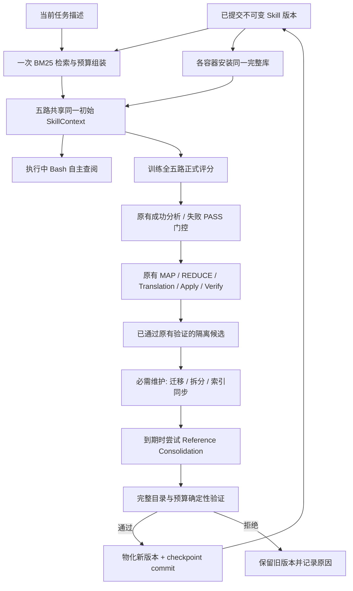

# Skill Maintenance + Hybrid Skill Routing 技术计划书

调研日期：2026-11-03。工作区：`D:/RSI-core`。本文只交付设计，不实施业务代码、配置、Skill 或依赖变更，不运行正式 SWE-bench 实验。

文中“现有”均依据本地源码；“拟新增”表示后续编码任务。相对源码路径均以工作区为根。Trace2Skill 对照对象是本地 vendored 源码及 `upstreams.lock.json` 锁定的 `3d0b52a140f002a512930252b613c49048f7d5ac`，不是对官方最新版本的声明。本次无需访问网络即可核查所需实现。

## 1. Executive Summary

目标是让知识库增长与求解时的初始 Skill 上下文预算解耦，不改变任务数据、Golden Patch、正式评分、轨迹截断或 mini-SWE-agent 源码。

推荐在 RSI 集成层增加三个能力：

1. **提交前维护事务**：现有 Trace2Skill 在 `trace2skill/skill-work` 完成更新与验证后，独立 Maintenance 在另一隔离候选副本上进行主文件迁移、必要的辅助文件拆分和索引同步。只有完整目录通过确定性验证才允许成为下一轮版本。
2. **按成功更新次数整理 references**：默认每 10 次已提交的学习更新检查一次，低成本检索少量相似文件，再由 LLM 提议去重、条件化合并或拆分。维护失败不得破坏已验证候选和当前版本。
3. **一次检索、五路共享**：`run_group()` 启动线程池前，对固定 Skill 版本与当前任务描述计算一次 BM25 Top-K，组装预算内的初始文本，传递给全部求解器。保留 Bash 读取完整库的能力。

关键默认值为主文件硬上限 10000 字符、目标 8000 字符、辅助文件上限 5000 字符、Top-K 最大 2、初始 Skill 总预算 4000 tokens；全部拟配置化，不能硬编码。字符与 tokens 是两套独立约束：10000 字符并不保证装得进 4000 tokens。

**最优先阶段是存储与事务兼容，不是直接接 BM25。** 当前通用 `file_map()` 忽略 `.yaml`；`SkillStore` 又把非可编辑文件视为固定工具。若直接添加索引，可能出现索引不参与版本哈希、恢复遗漏或被不可变检查拒绝。必须先解决这一层。

## 2. Current Implementation Analysis

### 2.1 已核实的执行入口与调用链

```text
run_experiment()                         rsi/agent/runner.py
  load_initial_skill() / SkillStore      rsi/skills/store.py
  run_lock() / initialize or resume      rsi/experiment/checkpoints.py
  _continue_experiment()
    skill = store.current()              每题只取一次版本路径
    run_group(task, folder, skill, ...)
      framework.prepare_task()           Trace2Skill 当前直接 return task
      ThreadPoolExecutor -> execute_one() × 5
        make_backend() -> install_skill()
        skill_prompt() -> {{ rsi_skill }} -> GuardedAgent.run()
      train: 全五路评分；test: 先 Selector，后仅评分选中一路
    build_all_supervision()
    frameworks.evolve_skill()
      skills.trace2skill.pipeline.evolve_skill()
        Success / Error 分析 -> filter_for_editor()
        CombinedParallelSkillEvolver.run(actionable)
        final-document-validation -> proposal.json
    store.propose() -> document_gate()
    checkpoints.commit() -> publish() -> skills/current.json
    下一题读取新 current
```

训练强制五路：`rsi/agent/rollouts.py::validate_execution_mode()` 要求 `evolve=true` 时使用 `parallel`、`rollouts=5`；线程并发数另由 `rollout_workers` 控制，不一定同时运行五个容器。所有线程收到相同的 `skill` 路径；正常流程中更新发生在所有求解与评分结束后。当前依靠版本目录约定、独立容器和 run lock 保持固定，没有对外部手工改写版本目录的持续防护。

训练的 `selected=None`、`success=None`，不计算训练任务正确率。冻结测试支持五路 Selector 或单路直接评分。五路测试 Selector 在评分前读取全部轨迹与最终补丁，不接收隐藏评分；仅对预先选中的补丁评分。不得把“任一路通过率”替代正式 Resolved Rate。

**不存在当前可调用的独立 Reflection 或 Updater 模块。** 失败分析 ReAct、成功报告及其解析承担更新依据生成；`rsi/frameworks/trace2skill.py::evolve_skill()` 转发实际 pipeline。`rsi/skills/updater.py` 源文件不存在；`__pycache__` 中残留名字不构成当前实现。`load_config()` 明确拒绝 `reflection_*` 和 `compression`、`skill_compression`、`updater_compression` 等旧配置。不得按旧架构恢复这些组件。

### 2.2 Trace2Skill 的本地真实行为

| 机制 | 真实源码、函数 | 行为与边界 |
|---|---|---|
| 来源锁定 | `rsi/skills/trace2skill/upstream.py::load()` | 核查 `rsi-source-manifest.json` commit 与各文件 SHA256，再导入 vendored 模块；直接改 vendor 会触发检查 |
| 成功分析 | `pipeline.py::evolve_skill()` 内部 `analyze()` | 成功路线一次 `RecordedClient.chat()`，使用 `analysis_prompt(True)`；官方 `analysis/parse_success_analysis_outputs.py::parse_items()` 解析 |
| 失败分析 | 同上；`rsi/skills/trace2skill/evidence.py::EvidenceReader` | 官方 ReActAgent 配合本地 `read_evidence/read_source/run_probe/evaluate_diagnostic_patch`，隔离源码诊断；达到分析上限后允许一轮报告收束 |
| 失败经验门控 | `rsi/skills/trace2skill/validation.py::filter_for_editor()`、`filter_failure_report()`、`verified_receipt()` | 先验证正式 PASS 与 task、analysis run、最终诊断补丁哈希一致，再解析 Failure Cause / Memory Items；未通过不会送编辑器 |
| MAP | `vendor/Trace2Skill-upstream/skill_evolver/parallel_evolving_agent.py::run_map_phase()`、`_run_single_map()` | Combined 子类构造成功/失败混合提示；各 proposal 基于同一个 `original_state`，RSI 传 `batch_size=1` |
| REDUCE | 同文件 `run_reduce_phase()`、`_run_single_merge()`；`parallel_success_evolving_agent.py::CombinedParallelSkillEvolver` | 分层合并，单份跳过；无有效合并时可保留输入批次；最后强制合并仍失败可能只返回第一份，不能保证所有提议保留 |
| Translation | `parallel_evolving_agent.py::run_translation_phase()` | JSON 默认管线逐条修正定位；`create/delete_file` 原样通过；其他条目失败可回退原编辑；同文件多条输出只取首条匹配编辑 |
| 确定性 Apply | 同文件 `run_apply_phase_programmatic()` | 在字典副本上依序执行 PatchEdit，产出完整 FileEdit；定位失败可能跳过，不等价于整批事务失败 |
| 写盘 | `skill_evolving_agent.py::SkillEvolver.apply_edits()` | 对工作目录创建、改写、删除；不能把其 docstring 的路径检查宣称当作实际完整安全检查，函数本体直接使用路径写盘 |
| 状态读取 | 同文件 `read_skill_state()`；Parallel 同名方法委托 | 读 `SKILL.md` 和 `references/` 直接子文件，不读 `routing/`，不递归 references 子目录 |
| 验证修复 | `ParallelSkillEvolver.run_verification_phase()` | 默认最多 3 轮；耗尽仍可能正常返回；不是“失败必定自动回滚” |
| RSI 最终验证 | `pipeline.py::evolve_skill()` 的 `validate_work_skill()` 与 `final-document-validation.json` | 包装上游验证增加 `validate_consistency()`，结束后另运行本地 quick_validate；最终不通过抛异常，阻止任务提交 |
| 候选接纳 | `store.py::SkillStore.propose()`、`document_gate()`、`validate_candidate()` | 保护固定工具，校验非空文档、本地链接和有限规则一致性；没有性能提升门槛 |

`pipeline.py` 首先 `shutil.copytree(skill, work_skill)`，不直接编辑已存版本。其返回 proposal 的 `changes` 是 `dict[path, str | None]`，`None` 表示删除；只收集 `editable()` 的路径。`store.propose()` 物化候选但不更新指针。实际主流程不用 `SkillStore.record()` 发布，而用 `checkpoints.commit()`；实现维护时必须保留这个单一提交点。

### 2.3 长度、文件限制与验证的实际强度

- `ParallelSkillEvolver.__init__()` 默认 `max_skill_lines=500`、`max_references=5`，RSI 未覆盖。它们进入提示中的状态/限制说明；相关提示还写有固定的“under 500 lines”。这不是 Python 字符硬限制，也没有观察到提交时确定性辅助文件数量上限。
- `skills/skill-creator/scripts/quick_validate.py::validate_skill()` 校验 frontmatter、name/description 等字段；description 的 1024 字符限制不是正文限制。它不检查主文件总体字符数或辅助文件数量。
- `rsi/skills/documents.py::validate_consistency()` 识别 Markdown 本地链接，以及特定 probe 重测矛盾；跳过 fenced examples，不是通用语义验证器，也不校验所有锚点、裸路径、HTML 链接或全库覆盖关系。
- `store.py::editable()` 只允许 `SKILL.md` 与单层 `references/[A-Za-z0-9_][A-Za-z0-9_.-]*.md`。`skill_files()` 另给分析器提供只读 scripts。没有 YAML 编辑通道。
- `rsi/core/common.py::file_map()` 只读 `.md/.py`；因此当前 YAML 索引既不进入哈希，也不进入通用复制字典。Docker `cp` 能复制物理 YAML，并不意味着存储/恢复支持它。
- `SkillStore.fixed_files` 是所有“非 editable”文件；以后若把 YAML 纳入读取但不拆分权限类型，就会把索引错误归入固定工具，连带改变 `tools_hash`。
- 单条上游 sanitizer 的通过不保证最终操作成功：引用编辑可能定位失败而 create 成功；最终应检验完整目录关系，不能仅检验 patch 中是否出现路径。

### 2.4 mini-SWE-agent 与容器路径

本地实际依赖位置由 `rsi/__init__.py` 的 `RSI_DEPENDENCY_ROOT` 控制，默认 `D:/RSI`；本次读取到的 mini-SWE 源码为：

- `D:/RSI/vendor/reasoning-bank/third_party/src/minisweagent/agents/default.py`：`DefaultAgent.run()` 使用 Jinja 渲染 system_template，额外参数进入 template vars，`execute_action()` 调环境执行 Bash。
- 同目录 `environments/docker.py::DockerEnvironment.execute()`：`docker exec ... bash -lc`，cwd 由 backend 提供。
- `rsi/agent/action_protocol.py::GuardedAgent` 是 RSI 层包装；本方案无需修改它或上游 DefaultAgent 的求解协议。

`rsi/agent/execution.py::skill_prompt()` 当前拼入 toolkit 标题、工具命令、按需读取说明和完整 `SKILL.md.strip()`，没有自动加载 references。`execute_one()` 将 `{{ rsi_skill }}` 加在 system_template 末尾，再调用 `agent.run(task['prompt'], rsi_skill=guide)`；Skill 内的 Jinja 字面量不会被当模板再次解析。直接扩大 `guide` 即可注入选中的辅助内容，无须 mini-SWE 改造。

`rsi/benchmarks/backends.py::install_skill()` 当前把完整目录复制到 **`/opt/rsi-skills`**：Docker 用 `docker cp`，Harbor 用 upload_dir，通用 fallback 用 file_map + JSON/base64。`SWEBackend` cwd 为 `/testbed`，`artifact()` 在代码仓库执行 `git add -A` 与 `git diff --cached <base>`。Skill 路径在仓库外，正常 `cat` 不会产生提交补丁。现有安装是容器内可写副本，不是只读挂载；五路不会因此改写宿主共享版本，但容器自身仍可能被模型改写。

### 2.5 Checkpoint 与日志

`rsi/experiment/checkpoints.py` 使用 schema 5。`commit()` 先原子替换 `checkpoint.json`，再 `publish()` 重建 current pointer、history、summary。`resume_request()` 核验 config/tasks 哈希、任务顺序及每个 Skill 版本；`archive_incomplete()` 归档未提交任务。`rsi/core/common.py::write_json()` 用同目录临时文件 replace，含 Windows sharing violation 重试。

因此维护后的完整目录必须在 commit 之前完成物化；记录路径、维护计数和最终版本必须跟随同一个 checkpoint entry。不得在周期维护中先调用 `store.record()` 或另写 current pointer。

## 3. Trace2Skill Compatibility Analysis

### 3.1 指定函数逐一对应

| 待核查名称 | 本地结论 |
|---|---|
| `_sanitize_map_patches` | 未发现该函数；这里对应 `ParallelSkillEvolver._enforce_create_pairing()`，调用在 JSON MAP 后、REDUCE 前 |
| `_sanitize_patch_edits` | 存在于 `SkillEvolver`，用于它的 `parse_llm_response()`；不可误认为所有 Parallel 执行路径都会经过它 |
| `_sanitize_translated_edits` | 存在于 `ParallelSkillEvolver`，主流程 Apply 前调用 |
| `run_apply_phase_programmatic` | 存在于 Parallel，主流程和 verification repair 均使用 |
| `read_skill_state` | SkillEvolver 实现，Parallel 委托；只认识主文件及 references |

JSON MAP 配对规则以单个 patch 为单位：create 必须被同 patch 的非 create 内容提到，非 create 引用的新路径必须存在或有同 patch create。MAP 实现对任意非 create 文件扫描，并非严格只看 SKILL.md；日志描述比实现窄。Translation 后的 sanitizer 则确实要求新 reference create 被**幸存的 SKILL.md 编辑内容**引用。即使磁盘中的 SKILL.md 原来已含同一裸路径，也不能代替本次 surviving edit 的配对条件。

新文件操作可能丢失的位置包括：MAP 配对过滤、LLM REDUCE 合并遗漏、强制合并回退首 patch、Translation 改变/丢失对应引用、后置 sanitizer 删除孤立 create、Apply 定位失败。JSON Translation 自身明确让 create/delete_file 直通，不能笼统断言它总会删除 create。Markdown semantic 管线也存在，但 RSI 默认使用 JSON；第一版不切换管线。

`SkillEvolver._snapshot_skill/_restore_snapshot` 存在，但 Parallel.run 虽取 snapshot，不能据此承诺整个 run 验证失败自动恢复；RSI 的有效隔离保障是工作副本和提交门控。独立维护不能依赖上游恢复不认识的 routing 文件。

### 3.2 两种实现路线

| 对比 | 直接扩展 Trace2Skill Patch Apply | 独立 Maintenance（推荐） |
|---|---|---|
| 索引写入 | 让 LLM 输出 YAML 文件编辑 | 程序从最终目录和受校验元数据统一序列化 |
| 必改层 | read_skill_state、MAP/translated sanitizers、repair 路径、path policy、snapshot/restore、提示和存储 | RSI 的候选事务、权限分类、索引验证和存储读取；vendor 不变 |
| Patch Schema | 可复用 create/modify 字段形状，但需新增 YAML 目标语义、成组校验与新配对政策 | 上游 schema 完全保留；增加独立 MaintenancePlan 和受信任 managed_changes |
| 配对 | create ref + index update 必须跨阶段保留 | 上游继续 create ref + root link；Maintenance 自己创建的文件以 index coverage 为接纳条件 |
| 版本锁定 | 直接改 vendor 与 source manifest 相冲突；需单独升级来源/审查 | 保留锁定源码及其校验 |
| 原子性 | 单扩 Apply 仍无最终 checkpoint 事务，必须额外做 RSI 工作 | 与现有 checkpoint 单提交点自然衔接 |
| 可靠性 | LLM 可生成过时/非法 YAML，多个修复阶段均要维护引用关系 | 路径/哈希/文件集合由确定性代码校验，LLM 只给语义建议 |

推荐方案的明确限制：**不能把“只建 reference + 更新 index”的 patch 直接送给未改上游。** 这些操作只允许由独立 Maintenance 事务执行。普通 Trace2Skill proposal 仍遵守旧配对规则；无需要求所有 reference 永久列在根文件中。维护可将纯导航长列表缩成索引访问说明，但任何有决策含义的引用、适用条件必须保留或迁移，并修复重命名链接。

维护后的目录仍可由上游读取根和 references。索引是对它透明的附加文件；固定 scripts/tests 继续保留。此方案不承诺普通编辑器会持续主动建 reference，超限迁移提供模型无关的结构维护兜底。

## 4. Target Architecture



拟新增 `rsi/skills/maintenance.py` 负责工作事务，`migration.py` 和 `consolidation.py` 负责内容计划；`index.py` 负责索引、路径集合与语义元数据验证；`routing.py` 负责检索与组装；`budget.py` 负责计数；`directory.py` 明确不同文件权限。模块名称为设计建议，不表示当前存在。

推荐入口在 `runner._continue_experiment()` 获得已验证 proposal 后、`store.propose()` 前：构建 base + changes 的隔离文件映射，调用 Maintenance，再一次性 propose。这样不必截断 `Combined.run()`，可保留其完整 verification loop；维护自己的最终校验再次运行 quick_validate 与现有一致性检查。`pipeline.py` 只增补文件权限边界和 proposal/原始更新 lineage，不能让维护版本重新进入上游 repair 后又被改坏。

## 5. Skill Directory Design

```text
skills/versions/<content_digest>/       # 一个完整、不可变版本
├── SKILL.md                           # 通用原则、适用边界、读取方法
├── references/
│   ├── debugging.md
│   ├── testing.md
│   └── api-compatibility.md
├── routing/
│   └── index.yaml                     # 拟新增，程序管理
├── scripts/                           # 现有固定工具，不可编辑
└── tests/                             # 现有固定检查，不可编辑

<task-folder>/
├── routing.json                       # 拟新增，一题一份决策记录
├── skill-context.txt                  # 拟新增，实际注入文本
├── maintenance/                       # 拟新增，位于 Skill 版本外
│   ├── plan.json
│   ├── migration.json
│   ├── consolidation.json
│   ├── coverage.json
│   ├── validation.json
│   └── usage.json
└── rollout-N/commands/...             # 复用现有原始 Bash 日志
```

### 5.1 索引格式（拟新增 schema 1）

```yaml
schema_version: 1
entries:
  - id: testing-contracts
    path: references/testing.md
    title: Regression testing and behavioral contracts
    description: Choose focused regression checks and preserve observable behavior.
    keywords: [pytest, regression, fixture, test, compatibility]
    applies_when: [A bug fix changes observable behavior or test setup]
    exclude_when: [Only documentation wording changes]
    content_sha256: "<64 hex characters of canonical UTF-8 content>"
    char_count: 2100
    provenance:
      - task_id: "<training task id>"
        rollout: 0
        evidence_id: "<analysis report/item hash>"
        evidence_kind: success       # 或 diagnostic_pass / legacy_unknown
    units:
      - id: regression-checks
        heading_path: [Testing, Regression checks]
        content_sha256: "<section hash>"
        self_contained: true
```

这些值只是结构示例，不是当前经验来源记录。历史文件没有来源时标记 `legacy_unknown`，不能追溯性伪造 PASS。provenance 只用短 ID 和哈希，原始报告/补丁留在宿主日志，不复制 Golden Patch 或评分内容进入索引。多来源可在外部 ledger 记录，index 中只保留有界摘要，避免索引因证据列表增长失控。

索引按 path 稳定排序；安全 YAML 加载、拒绝重复键、未知 schema、别名递归/过大输入、重复 path/id、越界路径。要求 `index.paths == 实际 references/*.md 路径集合`，且所有内容哈希、char_count 一致。描述、关键词、条件必须非空且有字段长度/数量上限（拟配置），`exclude_when` 为检索提示，不是自动证明不适用。整个 index 默认不注入。

不在索引存自身所属版本哈希，避免循环依赖；版本哈希由完整文件映射计算，外层 route/maintenance 日志记录版本。token 数是 tokenizer 相关的派生缓存，不能当跨模型权威值。

### 5.2 文件权限与旧版本兼容

拟新增三类权限，不能把 index 加入普通 `editable()` 后对所有 LLM 开放：

| 分类 | 路径 | 写入方 |
|---|---|---|
| editor documents | `SKILL.md`、严格单层 `references/*.md` | 上游 proposal 经校验、Maintenance |
| managed metadata | 精确 `routing/index.yaml` | Maintenance 的确定性 serializer |
| immutable tools/checks | 原有 scripts/tests 等固定文件 | 任何更新均禁止 |

拟新增 `read_skill_directory()` 专用于 Skill：保留旧 `.md/.py` 文件收集语义，并且仅额外读取精确的 `routing/index.yaml`，拒绝 symlink、路径穿越、大小写碰撞和非允许新文件。不要全局扩大通用 `file_map()` 为任意 YAML，否则会改变其他框架/日志的哈希语义。将所有 Skill 相关读取、hash、初始加载、materialize、gate、fallback install、execution tools_hash 调整到统一接口。

无索引旧版本按旧映射计算，哈希保持不变。新模式启用时，在**新实验的初始化准备阶段**从旧 seed 生成一个派生 seed，写索引、必要迁移、校验后再交 `initialize()`；保留原 seed 版本与 bootstrap 记录。无法在预算内形成派生 seed 就停止新实验，不静默切换。历史 resume 不自动增加索引或新配置；新模式默认关闭以保持旧 schema 5 行为。

## 6. Skill Migration Algorithm

### 6.1 字符计数与触发

统一规范：以严格 UTF-8 解码；输入 BOM 如存在仅在派生新版本时显式去除并记录；CRLF 和 CR 转 LF；输出恰好一个尾换行。字符数为最终序列化全文的 Python `len(text)`，包含 frontmatter、标题、空格、代码块与尾换行；不是字节数、行数或 grapheme 数。不执行隐式 Unicode NFC/NFKC 归一化，不改变代码字面量。

旧归档不就地规范化。新候选在计数前规范化，落盘后重新读取复算，并将 canonical UTF-8 哈希写索引。`len(root) <= hard_limit` 可以不做主文件迁移，但仍必须同步索引、检查变动 references。`target < hard_limit`；触发后优先达到 target，若受不可分原子单元限制，落在 `(target, hard_limit]` 可接受并记目标未达原因；绝不能超过 hard_limit。

### 6.2 结构识别与迁移顺序

第一版采用保守 Markdown 单元分析：识别 frontmatter、ATX/Setext 标题、完整 fenced code、列表/引用段落，保留源字符 span 和 heading path。不能用简单按 `#` 拆字符串。遇到无法可靠解析的表格、嵌套列表或未闭合 fence，保留整父章节或拒绝迁移，不猜测截断。

通用性的判别由有界 LLM 分类建议 + 程序保护规则组成：

- protected core：frontmatter、通用修复流程、诊断证据约束、验证/兼容原则、辅助库访问协议；跨任务均需且独立于特定 API/框架。程序不允许直接删除这些保护单元。
- specific：包含明确框架/API/失败症状/测试类型条件的可复用经验；优先迁移长、低频、条件窄且独立的章节。
- mixed：通用规则与例子混合；只能在保留原适用条件和前置步骤的前提下拆分，不能把条件留下而把动作孤立迁走。
- uncertain：默认保留；需要携带父章节依赖整体迁移，或在有限重试中重写结构。主文件全部是不可迁移通用约束时拒绝更新，不靠截断达标。

排序以确定性元数据为准：specific 优先，再按独立性、可节省字符数、稳定 heading path；已有真实使用频率可做后续信号，第一版不可把“未记录访问”当成“低价值”。通用性不是 LLM 一票证明，分类与理由进入日志。

### 6.3 执行步骤与知识覆盖

1. 在 candidate 文件映射中解析完整根文档，为单元建立 hash/id，提取规则的条件、行动、例外、验证步骤。
2. 以每个迁移候选的标题、关键字、内容建立查询，从现有 index + reference 内容 BM25 检索少量候选；不把整个库交 LLM。
3. LLM 输出结构化 `MigrationPlan`：迁移哪些 source spans、合并到哪一现有路径或拟创建路径、目标内容、原根替代内容、coverage 映射。
4. 程序校验 base hash、span 不重叠、保护单元不丢失、目标路径白名单，先构建并验证目标完整内容，再移除源内容；这是内存/工作副本内操作，不边改在线目录边迁移。
5. 第一版默认**原文搬移**以获得强覆盖检查；上下文前缀/标题可以补充。遇到重复规则，只在记录对应来源与保留目标规则、条件一致且有审核通过时去重。不能仅凭相似度删除。
6. 若目标 > `max_reference_chars`，按独立主题拆分后再放入 references。不可分超长经验无法满足限额时拒绝该计划。
7. 重新生成索引、修复所有受影响 Markdown 引用，检查不存在孤立 reference/悬空链接。迁移到 reference 内时按新文件位置转换相对链接，保持 scripts 访问正确。
8. 独立 coverage review 对比迁移前后规则单元：每个被移除单元必须映射到一个或多个目标单元；完整搬移比较原文 hash，去重/改写比较条件、动作、例外和验证。未映射、语义不确定或冲突未解释即拒绝。
9. 重算根字符数、预算可用性和文档结构；最多配置轮数继续迁移。记录每轮净减少量，无进展即停止。
10. 成功只返回完整候选与日志。失败拒绝本轮更新，保持旧 Skill pointer。

语义 review 只能降低丢失风险，不能数学证明等价；原文 span/hash 覆盖、保守不删除和留存旧版本是主要保障。维护对象是**上游 Apply 后的新候选**，不能用维护“顺便”抹去本轮新经验；上游本身可能已合并丢失的提议另以 MAP/REDUCE 差异审计标注，不宣称维护能恢复它。

```python
# 拟新增伪代码；没有调用当前不存在的实现
def migrate_root(candidate, cfg, planner):
    candidate = canonicalize_new_documents(candidate)
    for attempt in range(cfg.max_migration_rounds):
        if len(candidate['SKILL.md']) <= cfg.root_hard_limit_chars:
            return validate_complete_candidate(candidate)
        units = parse_markdown_conservatively(candidate['SKILL.md'])
        choices = rank_movable_units(units)
        plan = planner(choices, retrieve_target_references(choices, candidate))
        staged = apply_checked_plan(candidate, plan)  # source hashes + complete units
        validate_coverage(candidate, staged, plan)
        if len(staged['SKILL.md']) >= len(candidate['SKILL.md']):
            raise MaintenanceRejected('no progress')
        candidate = rebuild_index(staged)
    if len(candidate['SKILL.md']) > cfg.root_hard_limit_chars:
        raise MaintenanceRejected('hard limit unsatisfied')
    return validate_complete_candidate(candidate)
```

planner 每次被要求面向 target 规划，而停止条件最终以硬上限为安全边界。不得对 root 做 `text[:limit]`。

## 7. Reference Consolidation Algorithm

### 7.1 触发与成本控制

计数单位为**已提交且 accepted 的 Trace2Skill 学习更新**；不计任务尝试、失败、no_changes、bootstrap、单独重试和维护自己造成的文件变化。第 10/20/30… 次潜在成功更新时先尝试整理，再随最终 checkpoint 一起计数。若本次最终拒绝，计数不前进；resume 不重复累计。

每次普通更新必须检查受影响文件的单文件大小与索引一致性；超长新增/修改文件即时拆分属于必需维护，不等十轮。旧库全量超长处理在 bootstrap 完成。周期工作只检查变化文件及其相似邻居，再用一个持久轮转游标逐期覆盖未变化文件，避免同一少数文件长期占满候选预算。

拟配置 `candidate_neighbors=5`、`max_pairs_per_check=8`、`max_llm_calls_per_check=6`、`max_input_tokens_per_check=16000`、`timeout_seconds=180`。这些是待测初值；预算耗尽保留剩余队列到下一个周期，不自动无限追加调用。BM25 索引按版本缓存，首次构建 O(总文本长度)，更新只重建变动文档；避免直接全量 O(N²) 对比和全库 LLM prompt。

### 7.2 合并、冲突与拆分

候选先用规范化全文 hash/重复段落 hash 检出精确重复，再对标题、条件、关键词和正文 BM25 取近邻；合并对 `(min(path), max(path))` 去重，稳定排序。LLM 只读取有限候选完整文件及有界来源摘要，返回 `keep_separate / merge / deduplicate / split / conflict_unresolved`。

- 相同条件的重复规则可合并；互补步骤可组成有顺序的流程。
- 条件不同的策略必须保留各自条件，不能多数投票一并泛化。
- 冲突先检验证据来源和适用范围；正式 PASS 只证明相应诊断补丁，不证明抽取规则普适。多条同题路线视为相关证据，不能当多个独立任务。
- 无法解释冲突时保持分开，索引标注适用差异；不能只因经验更新或模型置信度高就删除旧规则。
- 合并文件必须 <= 5000 字符配置值；超限则按明确子主题拆分，并各自携带必要前置条件。
- 旧路径删除前扫描 root 和所有 references 的真实链接，更新引用；裸路径/代码示例中可能是实际使用命令，另外做路径清单核查。不可明确修复的入链存在时保留旧文件或取消合并，不能留下失效路径。
- 旧内容通过不可变旧版本与 maintenance 日志保留；不在 references 里留下大量旧备份，避免检索重复。

操作在必需维护通过后的候选上建立 savepoint。整个周期 batch 要么通过覆盖、大小、链接和索引验证，要么回到该 savepoint。这样周期整理失败可以接受原本有效的学习更新，并记录 `consolidation_deferred`；主文件迁移或索引同步等必需维护失败则拒绝整个学习更新。上游分析/API 基础设施错误仍遵循当前流程中止，不能被转换成正常无变化。

## 8. Hybrid Skill Routing Algorithm

### 8.1 静态初始路由

输入只使用当前 `task['prompt']` 和冻结 Skill 版本；不使用 Golden Patch、正式评分、未来测试反馈或其他路线中途发现。可选 repo 名称必须来自题面公开元数据，第一版只用 prompt。

检索实现第一版 BM25：文档字段为 title/description/keywords/applies_when/正文，字段权重、k1、b、词法版本均固化到配置指纹。建议英文 lowercase 后按标识符/词界拆分，保留原始 snake_case/dotted identifier 并加入拆分词，CJK 用稳定字符 bigram；停用词表版本固定。BM25 分数不是概率，候选需有有效非停用词交集且达到配置阈值，`score <= 0` 不加载。分数并列按 path 排序。

Top-K 是最多加载的**不同文件数**。候选先排序后预算筛选，前列过大且不可切分时跳过并尝试后续候选；没有相关内容时允许 0。预留 `Reranker.rerank(query, candidates)` 接口（拟新增协议），第一版恒等实现，不接 Jev、不引入远程检索调用。

`max_initial_skill_tokens` 计算完整最终 `rsi_skill` 文本，包括 core、toolkit 包装、工具列表、读取说明、已加载清单、辅助正文及其路径标题；不包括整个基础 system prompt 或用户题目，但另记完整初始请求 tokens。所有拼接完成后复算，不能仅逐段 tokens 相加。

tokenizer 必须与 solver model 对应，保存 tokenizer 标识/版本与计数方法。当前仓库没有可靠的目标模型 tokenizer 接口，因此编码阶段先做 `TokenCounter` 适配能力验证；没有可验证 tokenizer 时默认拒绝开启“严格 4000-token 预算”，不得用 chars/4 伪装保证。可另提供显式 `estimated` 实验模式，但与 strict 组分开标注；不属于硬预算验收通过。

**核心本身超 token 预算**：不得截断 core、静默提高预算或跳过核心。bootstrap 和每次候选接纳时检查 core + 固定包装是否可容纳；维护可继续迁移可迁单元来满足这第二约束。无法满足则拒绝新候选/新实验；旧归档作为只读输入可保留，但不能在 strict routing 开启后继续超预算求解。schema 5 旧运行不受新规则追溯影响。

### 8.2 大文件与结构化加载

优先整文件加载。如果文件超过剩余预算，仅可加载索引标注的完整、独立单元；必须包括 heading path、适用条件、前置定义与依赖单元。依赖闭包装不下则跳过，不截断句子、列表或代码块，不临时用 LLM 摘要挤预算。第一版可先只实现“整文件或跳过”，之后增加经过验证的 unit 级选取。

每个已加载项记录 `path/content_hash/unit_ids/full_or_partial`。提示明确“本轮已加载如下文件/章节；未加载章节仍可按需查阅”，不能把部分加载说成全文已读。加载清单自身计入预算，避免重复读取只做提示，不禁止重新查阅。

```python
# 拟新增接口行为
def route_once(task_prompt, snapshot, cfg, counter):
    index = validate_index_against_snapshot(snapshot)
    core = render_core_and_toolkit(snapshot)
    require(counter.count(core) <= cfg.max_initial_skill_tokens)
    ranked = retrieve_bm25(task_prompt, index, snapshot, cfg)
    chosen = []
    for candidate in ranked:
        if len(chosen) == cfg.top_k:
            break
        if not relevant(candidate, cfg):
            continue
        unit = complete_file_or_self_contained_units(candidate)
        trial = render_context(core, chosen + [unit])
        if counter.count(trial) <= cfg.max_initial_skill_tokens:
            chosen.append(unit)
    text = render_context(core, chosen)
    assert counter.count(text) <= cfg.max_initial_skill_tokens
    return frozen_context_and_route_record(text, chosen, snapshot, cfg)
```

### 8.3 自主 Bash 查阅与隔离

主文件保存简短说明（拟加入新版本，不修改现有 Skill）：

```bash
cat /opt/rsi-skills/routing/index.yaml
cat /opt/rsi-skills/references/testing.md
```

索引很大时用 `grep -n` 定位和 `sed -n` 分页，文件也可按章节读；现有环境/模型输出边界仍生效，不重设计轨迹截断。读取所得 observation 会继续占用后续调用输入 tokens；4000 是**初始 Skill 注入预算**，不限制后续 Bash 读取总量或整条轨迹。

生产 E 组与完整混合模式安装全库，并检查安装 manifest/hash 一致。推荐在 `SWEBackend.__init__()` 的 RSI 层追加只读挂载准备好的版本到 `/opt/rsi-skills`，复用上游 DockerEnvironment 的 `run_args`，`install_skill()` 在已挂载时只做验证；Windows Docker Desktop 路径需专项验证。不能只用 chmod 宣称 root 用户不可写。若平台不支持挂载，允许独立复制副本 + 前后哈希检测作为显式降级，记录 `snapshot_protection=copy_verified`，它不提供容器内强只读保证；strict frozen 模式要求只读能力，不满足时停止。Harbor/fake backend 保持适配分支并测试。

Skill、索引、安装清单和读取审计全部位于 `/testbed` 之外，执行器不得把这些复制进仓库或改 `.gitignore`。正常读取不会污染 patch；验收用实际仓库 diff 证明。模型主动把经验写进源码不能由目录隔离完全阻止，这属于求解内容行为；不采用可能掩盖正常修复的“过滤最终补丁文本”策略。

复用 `RecordingEnvironment._save()` 捕获原始命令，拟新增显式读取识别器：识别 `cat/head/tail/sed/grep` 的实际文件参数、解析 cwd、区分 index 浏览与 reference 阅读、是否已自动加载；记录命令尝试和返回状态。任意 Python、变量展开、shell 函数或管道无法可靠静态识别，分别标为 unknown，不能声称精确统计所有文件系统读取。必要时后续引入容器文件访问审计，第一版报告“可识别主动读取次数”及识别覆盖局限。

## 9. Integration Points

| 现有文件/函数 | 拟修改点 | 明确保留 |
|---|---|---|
| `rsi/core/config.py::load_config()` | 新配置块校验、disabled 默认、model/tokenizer 兼容检查 | 原模型路由、旧配置禁用规则 |
| `rsi/skills/store.py`：`load_initial_skill`、`SkillStore.__init__/propose/materialize/record`、document gates | 专用 Skill 读取；三类权限；managed changes 独立参数；新模式硬限额与 index gate；物化到 staging 后发布目录 | 旧无索引哈希、固定工具不可改 |
| `rsi/skills/documents.py::validate_consistency()` | 调用额外全目录索引/路径检查，扩充重命名链接验证；可把新增逻辑放独立模块 | 现有 probe 规则及历史 seed 行为 |
| `rsi/skills/trace2skill/pipeline.py::evolve_skill()` | before/after 全文件差异审计；上游写盘边界校验；记录 patch 丢弃统计；`validate_work_skill` 与最终 consistency 输入改用专用目录读取，避免合法 index 链接被误判缺失；proposal 不丢维护所需上下文 | success/error/PASS、MAP/REDUCE/Translation、最终原有验证 |
| 同文件构建 evolver 后的实例适配 | 包装该实例 `_evolver.apply_edits`：调用原方法前验证每个 FileEdit 路径与禁止修改 fixed/managed；覆盖 verification 写盘；不改 vendor | 上游确定性内容编辑语义 |
| `rsi/agent/runner.py::run_group()` | prepare_task 后、线程池前一次 route，存 SkillContext；传各 execute_one | 五路相同版本、评分与 Selector 时序 |
| `runner.py::_continue_experiment()` | proposal -> mandatory Maintenance -> 可选 consolidation -> store.propose -> gate -> commit；计数来自 checkpoint | 唯一提交点、上游异常中止语义 |
| `rsi/agent/execution.py::skill_prompt/execute_one()` | 接收预先组装上下文；记录 route hash/初始 tokens；tools_hash 只算 immutable | 模板变量注入、求解协议 |
| `rsi/benchmarks/backends.py::install_skill/SWEBackend.__init__()` | YAML 安装覆盖、安装 manifest、只读挂载能力与明确 fallback | `/testbed`、评分/harness/artifact 语义 |
| `rsi/agent/evidence.py::RecordingEnvironment._save/public_rollout()` | reference_read_attempts 及 route 标识，保留原始日志 | 原命令输出归档和轨迹裁剪 |
| `rsi/experiment/checkpoints.py::initialize/resume_request/commit/publish()` | 新模式 schema、目录完整性/route 哈希/维护计数；恢复幂等 | checkpoint 先提交再投影 |
| `rsi/experiment/tracking.py::summary_metrics()`、`run_logs.py::create_run_directory()` | 新指标、预算/索引版本、代码与 tokenizer 指纹 | 训练不计算 accuracy、test 才算 Resolved |

`rsi/frameworks/trace2skill.py::prepare_task()` 目前是 no-op，可作为 Trace2Skill 专属准备入口，但推荐 Router 放 runner 的一次性上下文准备层，避免把派生提示混入原 task manifest。新 feature 第一版仅对 Trace2Skill 模式开放，ReasoningBank 不静默改变知识读取策略。

## 10. Data Structures & Interfaces

### 10.1 拟新增配置示例

```yaml
skill_maintenance:
  enabled: true
  root_hard_limit_chars: 10000
  root_target_chars: 8000
  max_migration_rounds: 3
  max_llm_calls: 8
  timeout_seconds: 300
  core_token_gate: true
reference_maintenance:
  enabled: true
  check_every_n_updates: 10
  max_reference_chars: 5000
  candidate_neighbors: 5
  max_pairs_per_check: 8
  max_llm_calls_per_check: 6
  max_input_tokens_per_check: 16000
  timeout_seconds: 180
skill_routing:
  enabled: true
  top_k: 2
  retrieval_method: bm25
  max_initial_skill_tokens: 4000
  allow_zero_matches: true
  min_score: 0.0
  bm25_k1: 1.2
  bm25_b: 0.75
  tokenizer: "<verified tokenizer id, required in strict mode>"
  budget_mode: strict
  autonomous_reads: true
  require_readonly_snapshot: true
```

以上全部拟新增，不能直接认为现有 `load_config` 已识别或验证。维护模型第一版复用 `skill_editor_model` 配置但使用独立 RecordedClient/usage 目录，避免新增未审查模型角色；同模型不同阶段成本分开计。所有重试计入同一时间/call/token 上限，格式修复不能无限绕过预算。全 disabled 时保持旧模式。

配置验证：拒绝 bool 当 int、负数、非有限数和未知字段；`0 < target < hard`；周期与限额为正；`top_k >= 0`；b 在 [0,1]；k1 > 0。`allow_zero_matches=false` 遇到无相关或可装载项时返回显式 route_unavailable 并停止任务，不强塞不相关文件。index-required 模式缺索引必须 bootstrap，不能静默退回无预算全文。新的参考容量策略独立于上游提示 `max_references=5`，第一版保持上游提示不变并记录它的软约束影响；不宣称能通过只改配置消除提示中的 500 行文本。

### 10.2 拟新增对象

```python
# 类型草案，不是当前源码
SkillSnapshot = {
    'version': str, 'files': dict[str, str], 'index_sha256': str,
    'immutable_tools_hash': str, 'directory_schema': int,
}
SkillContext = {
    'skill_version': str, 'text': str, 'context_sha256': str,
    'initial_tokens': int, 'counter_id': str, 'route_id': str,
    'loaded': list[dict], 'skipped': list[dict],
}
MaintenancePlan = {
    'schema': 1, 'base_version': str, 'input_candidate_sha256': str,
    'operations': list[dict],        # move/merge/split/dedupe/rename
    'coverage': list[dict],          # source unit/hash -> target unit/hash
    'metadata_proposals': list[dict],
}
MaintenanceResult = {
    'document_changes': dict[str, str | None],
    'managed_changes': dict[str, str],  # 仅程序生成 routing/index.yaml
    'validation': dict, 'events': list[dict], 'usage': dict,
}
```

拟新增接口：`maintain_candidate(base, proposal, committed_state, config, folder)`；`build_index(files, metadata)`；`validate_directory(files, limits)`；`route_skill(task_prompt, snapshot, config, counter)`；`TokenCounter.count(text)`；`Reranker.rerank(query, candidates)`。不直接把 LLM 输出反序列化成可写文件操作，先核查 expected source hashes 和允许的 op/paths。

上游 `Patch/PatchEdit/FileEdit` 原样保留；RSI `proposal['changes']` 仍只包含 editor documents。`SkillStore.propose()` 拟新增 keyword-only `managed_changes` 和 `expected_base_version`，程序生成 index 后再传入，禁止上游 proposal 自带 routing 写入。propose 检查当前 base 与预期相同，避免未来并发写入覆盖。

`routing.json` 至少含 task prompt hash、Skill version、index hash、检索算法/词法/config 指纹、候选分数、选择/跳过原因、完整或部分单元、tokens、context hash、tokenizer。模型配置不保存凭证。五路 result 引用同一 route_id，不重复独立检索。

### 10.3 Manifest / Resume 演进

新功能模式拟使用 checkpoint schema 6；读取器明确分派 schema 5 和 6，schema 5 仅支持旧语义，不能静默升级已有 active run。schema 6 新增 `directory_schema`、`accepted_learning_updates`、`last_consolidation_attempt_update`、`last_consolidation_success_update` 和轮转 cursor。task manifest 原始内容不变，route 只记录 task prompt hash；config hash 包含新设置，resume 不允许覆写预算/路由参数。

每个 completed entry 内保存 route/maintenance 日志的相对路径与 SHA256、before/after version、维护计数变化和 decision。先写并核验 artifact，再提交 checkpoint。`publish()` 只重放这些已提交结果，不重新调用 LLM、维护或 Router；未提交尝试按现有机制归档，重试可以重新计算但不得复用与当前输入哈希不匹配的旧产物。新字段必须能幂等还原计数，不能从磁盘目录个数推断。

## 11. Failure Handling & Rollback

| 失败点 | 策略 | 任务/版本后果 |
|---|---|---|
| 上游分析/API/正式评测基础设施错误 | 延续现有抛异常，不把错误当 no_changes | 任务不提交，旧 Skill 保留，resume 重试 |
| 必需迁移不收敛、覆盖失败、硬限额不满足 | 生成 rejection 日志，映射为受控 `SkillProposalRejected` | 可提交已完成任务结果但 update rejected；版本不变 |
| index 元数据生成失败或文件覆盖不一致 | 有来源时仅用经过定义的确定性标题/关键词回退；仍不合法就拒绝 | 不允许缺索引发布 |
| 周期 consolidation 失败/耗尽预算 | 回到必需维护通过的 savepoint，标记 deferred | 可接纳有效学习更新；下个规定周期再尝试 |
| Router 无匹配 | allow_zero=true 时 core-only | 正常执行，仍受完整初始预算约束 |
| Router 核心超预算、tokenizer 不可信、索引哈希损坏 | strict 模式 fail closed | 不启动五路，不静默超预算 |
| 安装库缺文件/哈希不一致 | 中止该任务并清理容器 | 不从损坏的快照求解 |
| 版本写入中途崩溃 | 物化使用同磁盘 staging，校验后目录 rename；已存在 digest 必须核验 | 没有 checkpoint 引用的候选不成为 current |
| checkpoint 已写但 pointer/history 发布失败 | resume 根据 checkpoint 重新 publish | 不重复维护、计数或模型调用 |

主文件硬限额必须同时在 Maintenance 最终检查、`SkillStore.propose()` 新模式检查、提交前完整 gate 中落实；不能只依靠 planner 的指令。字节级完整性、固定工具、有效 frontmatter、链接关系、index 全覆盖、内容哈希、root/reference 大小、core tokens 是确定性 gate；语义保持 review 是附加 gate，明确其局限。

写盘安全要在上游实例的 `apply_edits` 调用前执行，不能等非法路径写完后再靠 `editable()` 过滤 proposal。确保维修回路也经过同一边界。既不修改 vendor 源码，也不只相信其注释或单个 sanitizer。旧模式行为是否启用这一防护需通过现有回归测试确认，但它不得授权原先固定文件变更。

周期整理与迁移后的所有文件和索引作为一个完整版本发布；没有“先发布文件、下一轮补索引”的中间状态。保留旧版本不是在线回写旧内容，而是根本不移动指针。磁盘损坏/OSError 不归类成正常拒绝，按当前异常中止流程处理。

## 12. Implementation Phases

以下均为下一阶段实施计划，本次没有执行。

| 阶段 | 现有文件/函数 | 拟新增文件 | 对历史实验影响 | 测试与验收 |
|---|---|---|---|---|
| P0：目录事务与索引基础（最高优先） | store 全链路、pipeline 写盘适配、backends.install_skill、execution tools_hash、config.load_config、checkpoints schema dispatch | `rsi/skills/directory.py`、`index.py`；`tests/test_skill_index.py`、`test_maintenance_transactions.py` | feature 默认关闭；旧无索引 seed 哈希、schema 5 resume 不变 | unit：权限、YAML 全覆盖、hash roundtrip；integration：五路假 backend 安装含索引、提交/崩溃恢复。验收：索引参与版本且不参与 tools_hash，任何部分提交不可见 |
| P1：字符预算与主文件迁移 | runner._continue_experiment、store gates、config | `maintenance.py`、`migration.py`、`markdown_units.py`；`tests/test_skill_migration.py` | 开启后 Skill 版本改变，单独新实验；不追改旧 runs | unit：边界、CRLF/Unicode、章节依赖、无损搬移、失败拒绝；integration：实际 vendored evolver + fake client 连续更新。验收：每个新接纳版本 root <= hard，失败保持旧 pointer |
| P2：静态 BM25 Router 与严格 tokens | runner.run_group、execution.skill_prompt/execute_one、store core gate、config | `routing.py`、`budget.py`；`tests/test_skill_routing.py` | 同 Skill 下求解输入变化，必须独立实验组 | unit：排序/零匹配/超预算/长单元；integration：五路同 context hash，目标 tokenizer 能力检查。验收：所有实际注入 <= token 上限，不改 mini 源码 |
| P3：周期 Reference Consolidation | runner 更新流程、checkpoint 计数、tracking | `consolidation.py`；`tests/test_reference_consolidation.py` | 仅启用周期组演化不同；每次接受仍同一事务 | unit：重复/互补/冲突/拆分/入链；integration：第 10 次触发、reject 不计数、resume 不重跑。验收：候选预算有界，无孤立/悬空文件，周期失败不破坏有效候选 |
| P4：完整 Hybrid 与观测 | backends.SWEBackend/install_skill、evidence._save、execution 结果、tracking/run_logs | `read_audit.py`；`tests/test_skill_access.py` | 自主访问能力显式记录；读取 token 单独统计 | unit：读取识别及 unknown；后续授权的轻量 Docker integration：未加载文件可读、只读保护、git diff 不含安装产物。验收：真实路径可用、日志区分注入与读取 |
| P5：受控对照与报告 | 未来新实验配置及报告脚本，不改现有 task 数据/harness | 拟新增实验配置、分析脚本（名称实施时确定） | 新实验，不复写历史结果 | 固定训练/测试任务、模型、预算，执行 A–E；验收：有完整预算与成本记录、统计口径一致、未知 B 状态透明 |

P0 先交付可独立 review 的持久化与恢复契约，再做 LLM 内容改写。P1 不依赖 P2 的严格 token gate 成功就能验证字符不变量；正式开启完整 routing 前必须补齐 tokenizer、core token gate 与 bootstrap 验收。每阶段默认开关独立，组合配置必须明确不允许的状态。

## 13. Testing & Ablation Experiments

### 13.1 功能与回归测试矩阵

| 用例 | 输入/操作 | 必须断言 |
|---|---|---|
| 根低于/等于硬上限 | 9999/10000 canonical chars | 正常更新，无不必要主文件迁移；index 正常同步 |
| 超过上限 | 10001 或更长 | 触发迁移；接纳结果 <=10000，优先 <=8000 |
| 规范化 | CRLF、CR、中文、emoji、BOM、尾换行 | 磁盘重新读取后的 len/hash 与 gate 一致；旧 seed 不被改写 |
| 合并已有主题 | root 的测试经验与 testing.md 同主题 | 合并或保守追加到合法文件，所有 source units 有映射 |
| 新主题 | 无合适候选 | 新建 reference + index，根不残留已迁移长正文 |
| 不可拆内容 | 跨章节依赖、fence、长原子单元 | 整体迁移或拒绝，不截断语义/代码 |
| 重复经验去重 | 条件相同/条件不同两类 | 前者有 coverage/evidence，后者不得盲目删除 |
| 迭代不收敛 | mock planner 多次不减长度 | 有限调用后拒绝，旧 pointer/current hash 不变 |
| 周期合并 | 10 次 accepted 与穿插 rejects/no_changes | 精确到期执行，拒绝/重试不增加次数 |
| 合并后过大 | 两个 4000-char 文件 | 分主题拆分或拒绝，不接纳 >5000 的新 reference |
| 索引一致性 | 少 entry、多 entry、错 hash、duplicate key | 全部拒绝；新建/删除/重命名后集合相等 |
| 原有链接 | root/ref 入链、相对路径、锚点、代码块路径 | 修复有效入链，无法判断的保留/拒绝，旧引用不损坏 |
| 路径安全 | ../、绝对路径、反斜杠、symlink、大小写冲突、非法修复 FileEdit | 写盘前拒绝，scripts/tests 未改 |
| Top-K | 正相关 3 个，K=2；全无匹配 | 最多两文件；无匹配 core-only；稳定 tie-break |
| tokens | 包装使组合超限、核心自身超限、tokenizer 缺失 | 精确重算后跳过或 fail closed，不能 chars/4 冒充 |
| 长文件预算 | 剩余预算不足 | 整文件跳过或独立完整单元；partial 清单准确 |
| 五路冻结 | 故意随机完成顺序 | route/context/Skill version 全相同，期间不发布更新 |
| Bash 未加载项 | Router 未选 testing.md | full 模式下 cat 成功；命令/观察记账；不会进 git patch |
| 快照不可变 | 尝试容器改 Skill | strict 模式写失败；复制降级只能检出且标记，不声称只读 |
| 崩溃恢复 | 物化中、checkpoint 前、checkpoint 后分别故障注入 | 没有半索引，已提交任务不重复 LLM，不重复计数 |
| 长期不变量 | 100+ 次 fake 学习更新和随机 merge/split/reject | 每个 accepted version 满足 root/reference/index 条件，知识覆盖可追溯 |
| 旧版兼容 | 无 YAML 历史 seed/schema 5 checkpoint | 哈希、固定工具、恢复结果保持原语义 |

优先复用 `tests/test_skill_directory.py` 的真实 vendored MAP/REDUCE/Apply fake-client 测试，`test_checkpoints.py` 的提交前后故障测试，以及 `test_skill_update_regressions.py` 的失败报告与一致性修复案例。后续回归至少覆盖 `test_trace2skill.py`、`test_failure_pass_gate.py`、`test_upstream_alignment.py`、`test_core_baseline.py`、`test_action_protocol.py`、`test_rollout_concurrency.py`。本次不运行这些测试，不启动容器或模型调用。

### 13.2 A–E 对照设计与本地差异

| 组 | 用户要求机制 | 本地可实施定义 |
|---|---|---|
| A | 原始 Trace2Skill | 使用当前 pinned RSI Trace2Skill 集成基线，关闭新增 maintenance/routing，保留现有 PASS gate 和原有按需 references 能力；不是官方 spreadsheet 原始 benchmark |
| B | 原始 + 现有整体压缩 | **当前源码已移除/禁用整体压缩，不能直接配置运行。** 先找可复现历史源码与配置；若不可得，将独立 compression baseline 标记为拟新增、单独授权实现，否则该组 N/A，不伪造结果 |
| C | 主文件迁移 + Top-K | P1/P2，关闭周期整理与额外自主访问实验能力 |
| D | C + 定期合并 | 在 C 上启用 P3 |
| E | D + Agent 自主查阅 | 启用完整库访问、访问提示与观测，使用真实 `/opt/rsi-skills` |

当前 A 原本就允许按需读 linked references，因此 A→C 不是只增加一个开关的纯因果对照。报告必须明示这一点。为了使 D→E 有效，C/D 的实验环境只安装 root、固定工具及自动加载的选中文件，不安装其余库或索引，提示也不宣称全库可读；这是**消融专用安装视图**，宿主完整版本仍保留，不用于生产 hybrid 模式。标记安装视图哈希；不要静默把不完整库冒充完整 Skill 快照。也可以补充 C-full/D-full 组，让其全库可读但仅关闭访问提示，衡量提示效果；这测的是提示而非能力，必须分开报告。

B 仅研究 Skill 文本压缩，不启用轨迹压缩；历史压缩若同时改变轨迹或模型，应作为历史参考而非严格对照。建议补充 A-core（统一只注入 root、无额外库读取）和等预算 core-only 组，区分 core 变短、自动检索和主动查阅各自贡献。

两层实验：

1. **固定更新输入回放**：用相同已归档合法 analysis/proposal 输入比较迁移/整理结构、覆盖、维护成本。无法评估真实 Resolved Rate，只验证维护效果。
2. **在线训练 + 冻结独立测试**：各组使用相同初始来源、训练序列和测试集，训练后冻结最终完整目录。测试固定五路+同 Selector 或全部单路，不跨组混用；禁止根据测试得分回头修改 Skill。

固定 solver/editor/judge 模型及版本标识、temperature、step/cost/wall-time、action repair、正式评测配置、任务顺序与可用 seed；provider 不支持 seed 时如实记录不可完全确定性，多次独立重复。不能只写“固定随机种子”就声称云模型输出可复现。Flash/Max 差异可做第二维实验，但第一轮同组比较不同时更换模型。当前配置强制分析/编辑使用 Max；用户观察的历史 Flash 建文件差异仅作为待验证假设。

### 13.3 指标定义

| 指标 | 口径/采集点 |
|---|---|
| SWE-bench Resolved Rate | 冻结测试中选中补丁的 resolved / 完成正式评价任务数；另报基础设施失败与覆盖任务数，不能丢弃失败样本美化 |
| 主文件字符数 | canonical root len，逐版本/逐任务 before-after、最大值、分位数 |
| 目录总字符数 | 分别报 root+references+index 的知识字符数，及含 scripts/tests 的完整目录字符数；不含宿主日志/历史版本 |
| 初始 Skill tokens | 实际 SkillContext 最终文本，每路线和五路合计；相同文本仍被五路使用，不是只收一次费用 |
| 总输入 tokens | solver、action repair、Selector、Trace2Skill 分析编辑、Maintenance 分项及端到端总和，去重计算 usage；同时报冻结测试单题 |
| 辅助文件数 | 当前版本 index/files 校验后数量，及大小分布 |
| 合并/迁移次数 | 同时报 attempted、succeeded、committed；split 与 merge 单独统计，回滚不计成功 |
| Router 选择数 | 不同文件数、加载单元数、零匹配率、预算跳过数 |
| 主动读取次数 | 可识别 reference 读取尝试/成功命令、index 浏览、重复读已加载项、unknown；不是全部系统调用的精确数量 |
| 主动读取 tokens | observation 文本 tokens 与其后续重复携带成本分别说明；总输入以 provider usage 为准 |
| 维护 API 成本 | RecordedClient 输入/输出/reasoning tokens、calls、墙钟；价格缺失时 cost_usd=null，不能当 0 |
| 质量/稳定性 | 覆盖拒绝率、冲突保留率、维护失败率、索引错误、恢复错误、route 命中人工抽样 |

初始上下文降低不等于整任务输入降低：system 文本会在多步调用中反复携带，主动读取又会增加 observation，维护也需要 API 调用。分别报告求解节省、维护开销和端到端净成本。使用配对任务结果与 bootstrap 置信区间，重复运行报告方差；不能以单次少量任务的提升宣称普遍收益。

## 14. Risks & Open Questions

1. **目标模型 token 计数**：需要在 P2 前确定 Qwen 对应 tokenizer 的可获得性、版本和消息计数边界；无法验证时严格预算模式不进入正式实验。不能把 tokenizer 未解决藏在默认估算中。
2. **通用核心可能本身过大**：字符硬上限与 token 上限会同时约束核心；保留不可迁移原则后仍超限则必须拒绝或明确调整未来实验配置，不能在运行中自行放宽。
3. **语义维护损失**：去重和条件合并依赖模型判断；先原文搬移，限制每次影响范围，保留 coverage 与旧版本，冲突不确定时不合并。
4. **上游软限制仍影响建文件倾向**：500 行/5 reference 的提示与新维护策略不完全一致。第一版不改 vendor，接受其软引导影响并测量；未来若需改提示，建立明确的 RSI prompt adapter 与快照测试，不能绕过 source manifest 校验偷偷改 vendor。
5. **编辑器输入仍会随库增长**：上游 `read_skill_state()` 和本地分析输入包含全 Skill 内容；本方案主要限制 solver 初始输入，并没有解决 Trace2Skill 全库分析编辑成本。指标必须单列；后续研究 updater retrieval 需独立设计，不能在本次顺便缩减分析证据。
6. **目录成长没有总量硬 cap**：单文件大小、周期去重和路由控制不能保证总库有界；索引和维护成本可能增长。先记录增长曲线，后续再考虑归档/淘汰策略，不把未访问经验直接删除。
7. **只读安装平台差异**：Windows Docker Desktop 与 Harbor 挂载能力需 P4 验证；复制+hash 是较弱保障，不能伪称运行过程中完全冻结。
8. **B 组可复现性**：当前只有历史文件/缓存痕迹，不存在可直接启用的压缩模块。下一阶段首先确认历史实现来源，否则 B 保持 N/A；本次不恢复它。
9. **Checkpoint 迁移风险**：新目录分类影响初始加载、版本 hash 和 tools_hash；必须独立测试所有读写调用，尤其 `load_initial_skill` 与 fallback install，不只改 proposer。
10. **真实读取归因**：命令日志能可靠证明显式 cat 观察，但不能覆盖任意读取方式；第一版观测口径必须诚实，不能拿字符串提到路径的次数当实际使用次数。
11. **当前目录不是 Git 工作树**：本次 `git status` 返回 not a git repository；后续实施需以文件快照/校验与独立版本管理安排审阅，不能假设可直接生成当前工作区 Git diff。

首个编码任务建议限定为 P0：实现专用目录读取与三类权限、程序管理索引、完整候选验证及 checkpoint 恢复测试，保持全部新功能默认关闭。P0 验收之后再进入迁移与路由，避免把内容算法建立在索引可能丢失的存储机制上。
